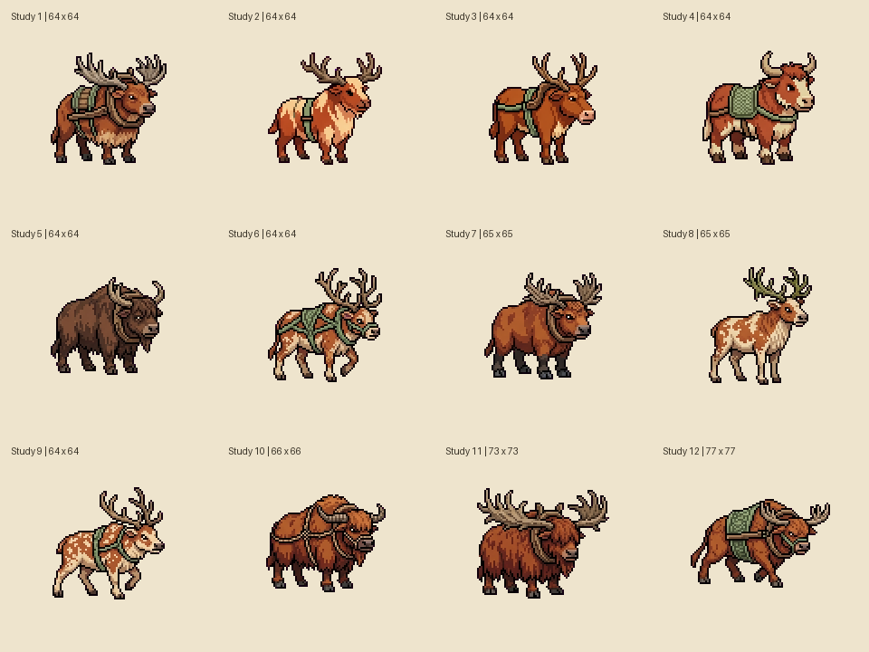

# Brindlehorn concept studies

Twelve alternatives from one Sprite Fusion generation request on October 30, 2026. These establish a possible earthy palette and sturdy wagon-hauler silhouette. They are draft concepts, not final creature designs or an animation sheet.

Study 1 is the initial working reference for its broad antlers, visible harness, and readable body. Study 11 is useful for its shaggy weight and silhouette. Neither is a final selection. The next art pass should make the hollow reedwood antlers more distinctive, align the pose to a strict side view, and test the creature beside the wagon at actual game scale.

The numbered PNGs preserve the API outputs unchanged. The contact sheet only arranges them, labels them, and enlarges them with nearest-neighbor scaling. Although the request used size 64, the service returned images ranging from 64 to 77 pixels square. Verify and normalize dimensions before building an atlas; these files are not production-ready frame sequences.

The [generation record](brindlehorn-generation.json) contains the prompt, request ID, original batch indices, asset IDs, source URLs, dimensions, and local paths. Use an asset ID as input for later edits or animation and keep new revisions alongside the source. A download interruption was recovered from the saved assets endpoint without repeating generation.

For production, edit the selected pose first, establish a matching style across the roster, and animate approved poses. The first playable needs side-view idle and travel motion. Eight-direction sets and normal maps remain optional later work. API credentials are not stored in this repository or included in a game build.

See the [game design document](../../docs/GAME_DESIGN.md) for each creature's role and the [Sprite Fusion API documentation](https://www.spritefusion.com/docs/pixel-art-generator/api) for the art tooling.
