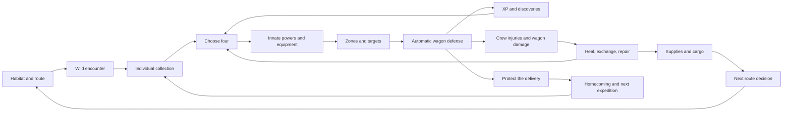

# Trailomon integration blueprint

November 4, 2026. Companion to [PLAN](PLAN.md) and [ROADMAP](ROADMAP.md). Implementation contract; proposed systems are not shipped behavior. Numeric tuning remains experimental unless explicitly identified as shipped.

## Connections before features

The wagon connects combat to travel. Individual identity connects collecting to growth and builds. Geography connects ecology to risk and discovery. Prefer these connections to adding another currency, independent progression track or permanent meter.

### A worked expedition

1. A solo Brindlehorn leaves with orchard cuttings. A visible early threat teaches its protective passive and wagon defense. This is an authored solo-capable encounter, not hidden scaling to erase stronger teams.
2. At Split Oak, a Loamling follows its root-trail waybed. Its active exposes a foe; its digging can help feed the crew. Another combat specialist need not supply a field action.
3. A discovered item strengthens ordinary hits against an opening. The compatible socket and effective change appear on the creature sheet. This illustrates the desired interaction; the item is not currently shipped.
4. At an ambush, a protector covers the raider's zone while an attacker focuses that threat. Target lines explain the setup. A different formation may protect the creature while exposing the wagon.
5. Victory awards each eligible individual XP once. The result shows growth, a wounded protector and wagon consequences. Leveling does not heal.
6. At a stop, the player chooses treatment or a reserve. The exchange preview shows food demand, hauling changes and gear retained in the wagon.
7. The final fork presents different exposure, threats and discoveries. Fewer shelters make health, food and wagon condition part of the route decision. Proposed component damage would deepen this connection.
8. Home retains identities, levels, discoveries and stories. The next departure has new possibilities but still needs supplies.

## System ownership

| System | Owns | Reads | Produces | Boundary |
| --- | --- | --- | --- | --- |
| Collection | Individual ID/name/origin/resident record | Species, stop access | Recruitment, exchange, homecoming | No stale home copy overwriting live travel XP/health |
| Growth | Total XP, versioned derived level | Eligible settled encounters | XP receipt and changed combat baseline | No free healing or passive food discount |
| Innate kit | Active, passive, targeting override, optional field use | Ecology/body identity | Combat hooks and road help | No mandatory class/type chart |
| Equipment | Definition, ownership, socket assignment | Slot layout, location, discovery | Derived stats and bounded triggers | One inventory for travel and combat |
| Encounter | Stable ID, composition, costs, rewards | Route, habitat, flags | Setup or alternate resolution | No RNG from rendering/inspection |
| Combat | Unit snapshots, positions, clocks, effects, outcome | Individual stats, gear, wagon | Events and settlement proposal | Does not directly mutate expedition through GUI |
| Care stop | Services and quoted price | Injuries, reserves, location | Heal/revive/exchange transaction | Opening/reloading never heals |
| Wagon | Roadworthiness; proposed component state | Terrain, load, damage, repairs | Travel limits and repair result | Does not duplicate delivery quality |
| Cargo | Delivery quality, packed goods; proposed protection | Load, cover, named hazards | Contract result, goods at risk | No unreadable per-item durability |
| UI | Selection, help, animation | Read-only state and previews | Commands | Never calculates authoritative rewards/damage |

### Atomic hand-offs

- **Start battle:** validate readiness; snapshot individual IDs, stats, gear, formation and wagon. Lock swaps/equipping. Charge entry effort at one documented point; preserve free pre-action return where supported.
- **Finish battle:** one stable encounter ID owns one receipt: individual health/energy, wagon/cargo/supplies, eligible XP and discoveries. Commit once before showing the result. Continue/reload cannot settle again.
- **Care:** calculate and show the exact outcome/cost, validate location/funds, then apply once. Reviving a KO is explicit. Rendering never advances a care day.
- **Exchange:** validate reserve/active slot, preserve outgoing identity/injuries/XP, detach gear into inventory, insert incoming individual, validate hauler/capacity, commit. Failure changes nothing.
- **Equip:** validate ownership/slot/mode and move the item rather than copy it. Recompute effects from the same definitions used by combat and travel.
- **Discover:** knowledge is separate from possession. A full wagon can decline the physical find while keeping its catalogue discovery. Never silently overfill or lose the find without explanation.

## Combat rules to implement

### Two zones and explicit target order

Each side has an upper and lower zone; each zone has a 2×2 formation. Four companions occupy up to eight friendly positions. Positions are meaningful spaces, not extra party slots.

| Zone | Friendly rear | Friendly front | Opposing front | Opposing rear |
| --- | --- | --- | --- | --- |
| Upper | 3, 4 | 1, 2 | 1, 2 | 3, 4 |
| Lower | 7, 8 | 5, 6 | 5, 6 | 7, 8 |

Ordinary targeting sorts by opposing zone, then front/rear, then nearest position, then stable tie-break. A rear foe in the facing zone can precede a front foe across zones. KO immediately retargets. Document the order of lure/taunt and named skill overrides; test both.

**Wagon exception:** a clearly marked Raider can reach the wagon through a zone without an eligible living defender. Other opponents prefer creatures. Show a line ending on the wagon and “Wagon exposed.” Interception cannot also charge the original wagon hit. This is our rule, not claimed Astronarch parity.

Give the initial party a comprehensible default formation. Selecting a creature then clicking a slot is enough; occupied positions swap. No drag-only operation. Both friendly and enemy inspection explain the current target and exceptions. Setup is reversible until the announced commitment point.

### Skills, passives and equipment

Independent attack clocks and Focus refill remain separate. Active skills repeat at their threshold. Passives use identifiable triggers: interception, shield, exposure, interrupt, being hit or battle opening. Items modify those levers without a second ability tree.

Define per-hit/per-cast/per-tick limits and sources. Reactions cannot recursively trigger themselves. Shields do not heal; additional hits do not generate an infinite loop. Display effective HP/ATK/DEF/attack interval/Focus cost from the resolver's calculations, with base/modifiers available on inspection.

Enemy jobs create different decisions: Raiders test zone coverage; disruptors test interruption/focus; front anchors test sustain/openings; rear attackers test placement/reach; guardians test stronger authored patterns. These are encounter-authoring terms, not fixed species classes. Use the existing species before multiplying similar enemies to appear varied.

### Reference boundary

Astronarch's official description emphasizes positioning and items; its developer FAQ describes armor, shields, timing and trigger distinctions. Zone/front/nearest order is documented in a player-written guide/discussion, not verified source-code access. Trailomon adds wagon defense, travel condition, individual XP and care stops.

Sources: [official store](https://store.steampowered.com/app/1234940/Astronarch/), [developer FAQ](https://steamcommunity.com/app/1234940/discussions/0/3112519935871524178/), [player formation guide](https://steamcommunity.com/sharedfiles/filedetails/?id=2395108692), [targeting discussion](https://steamcommunity.com/app/1234940/discussions/0/4677521348360220599/). Use original assets, species, item names and text.

## Growth, care and individual identity

Store XP on the individual, not species/party index. Derive level from a versioned curve. A duplicate starts its own record. A reserve exchange cannot inherit another slot's XP. Preserve earned XP on unsuccessful delivery/early return.

Award participants in qualifying victories, including those knocked out during that fight; exclude those unready at battle start. No last-hit reward competition. Practice is bounded and cannot be farmed. Show the eligibility rule in the XP tooltip/result. Modest growth must leave route knowledge and formation relevant; do not automatically scale enemies to current level. Evaluate newcomer catch-up only if full runs show recruits becoming dead weight.

Care hierarchy: stop services offer predictable revival/recovery and reserves; field camp trades time/food for recovery; medicine supports focused care far from help. Quotes show resulting Condition/Energy, revival, coins/medicine, meals and days. Avoid three buttons with nearly identical unclear outcomes.

Wayhome roadkeepers exchange waybeds at established stops; services diminish deeper into wilderness. Outgoing wounds persist in reserve. No heal-by-store/retrieve; no mid-combat exchange. End-of-trip recovery is a distinct explicit event. Gear belongs to inventory, even when its wearer goes home.

## Items and catalogue

The catalogue is complete for **implemented items**, not for a hypothetical 300-species expansion. Include current consumables and tools. Planned definitions are not presented as obtainable.

Every item needs: stable ID, name, original semantic icon, category, slot compatibility, weight, source, persistent discovery, ownership/location, implemented effect and validation. Avoid five disguised +1 attack objects.

| Family | Interaction | Connection |
| --- | --- | --- |
| Striking | Conditional ordinary-hit benefit | Exposure/target focus |
| Guarding | Shield or interception benefit | Wagon protection/repair needs |
| Tempo | Attack/ability timing tradeoff | Innate passive and independent clocks |
| Trail gear | Haul effort, rain protection, bounded gathering | Route, food and recovery budget |
| Care/supplies | Recovery and repair | Load and remote survival |

The **sheet equips**, the **catalogue explains/discovers**, the **shop sells**. All read one definition/inventory. Link between them instead of cloning three item-management dashboards.

First-slice item knowledge persists while gear is packed per expedition, matching current provisioning. Explain this at departure/return. Permanent gear is a later decision if repeat shopping proves tedious, not an accidental new economy in this pass.

## Wagon and cargo proposals

### G1 — functional components

Running gear controls mobility/haul strain; frame controls structure/load safety; cover controls exposure. Show parts on the wagon. The journey needs a derived roadworthy summary, not three new permanent bars. Use clear condition bands with exact values on inspection.

Map causes to parts: rough terrain strains running gear, impact harms frame, weather tests cover. Never roll hidden damage across every part simultaneously. Compare field patch and service repair using existing supplies/time/coins. A patch gets moving with a stated limitation; service repair restores the part. Show derived speed/load changes before departure. Every breakdown needs repair, alternate-route or assistance exit.

Old wagon % requires explicit migration or old journey rules until completion. Do not turn one damaged wagon into three undamaged parts. Active saved fights finish under their original rules.

### G2 — protected loads

Two protected positions and an exposed rack, within existing weight/capacity. Group goods into a few recognizable loads; make only meaningful protection choices selectable. Delivery crates remain visible. Cover, rain, raids and utility gear decide what is threatened.

A load has exactly one location; moving it changes protection, not ownership/weight. Delivery quality stays separate from structure. No Tetris, rotations, per-apple durability or manual meal unpacking.

Acceptance example: protecting food preserves future meals but exposes the orchard crate; cover repair or a weather-adapted creature changes the sensible arrangement. The player predicts this from the wagon and route views. Validate before adding bays or cargo categories.

Both proposals are gated by owner votes and can ship independently. If rejected, improve current-resource clarity and continue combat/growth integration.

## Visual acceptance contract

### Information hierarchy

1. Always visible: next decision, relevant readiness, cost/danger, destination and immediate action.
2. On inspection: effective stats, exact targeting, part condition, item effects and cost breakdown.
3. Journal/catalogue: sources, ecology, history and longer rules.

Essential warnings never live only in hover. Avoid the same full ledger on every screen. Context panels show the current decision rather than unrelated statistics.

| View | Dominant visual | Essential readings | Details/exits |
| --- | --- | --- | --- |
| Journey | Route and moving wagon | Destination, food outlook, next threat/stop, four portraits | Node, sheet, wagon, pause |
| Encounter | Wagon at the event on the same map | Situation, cost/reward, two to four choices | Enemy inspection, full scene, safe leave if supported |
| Formation | Shared field and two zones | Targets, wagon exposure, readiness | Click creature/slot, inspect, gear before lock |
| Battle | Creatures and local feedback | HP, Focus, attack progress, wagon danger | Pause/speed, inspect, retreat cost |
| Result | Same survivors and wagon | XP/level, injury, find, resource delta | Continue to map; inspect why; nearest care |
| Sheet | Creature silhouette and sockets | Identity/level, health/energy, active/passive, equipment | Stats/help, origin/history, next individual |
| Rest stop | Shelter and party | Care quote, reserves, next-leg outlook | Exchange preview, repack, return |
| Wagon | Parts and loads on wagon | Roadworthiness/load/delivery, actionable damage | Repair comparison, load inspection |
| Catalogue | Purpose-grouped item silhouettes | Discovery count, source, ownership, slot match | Entry, compatible creature, shop |

### Travel and encounter entry

- Resolve and save one day once; animate previous progress to saved progress. No animation callback charges another day.
- Keep the map transform stable during motion and arrival. A panel must not teleport the wagon or change its apparent location.
- Mark known threats/stops before arrival. Settle the wagon, open the contextual choice, stop time. No extra “enter encounter” click.
- After resolution, use a compact consequence. Remove redundant full-screen acknowledgements followed by another Travel click; retain pauses for genuinely new decisions.
- Define menu/focus/save-failure behavior. Reduced motion snaps to the correct endpoint with the same choices. Reload resumes saved state, not an animation payment.
- Actionable labels behave as actions/inspection. Scenery should not masquerade as a button.

### Help and visual language

Use a shared glossary keyed by semantic IDs. Underline explainable rules such as Focus, Front, Raider, Shield, Condition and Load. Do not underline every word or number. Hover, keyboard focus and click offer the same information; click can pin help. Escape dismisses help before navigating. Delay hover slightly to avoid flashes. Clamp within the window and avoid covering the inspected unit's bars/target line. Keep nested explanations shallow; long detail belongs in the guide.

Retain `ui/iconography.lua`, `ui/icons.lua`, shared readings and colors. New concepts need intentional distinct glyphs and canonical labels; never screen-specific recoloring of old concepts. Exact costs, signed deltas and warning words are independent of color. No decorative badges, generic gradients or text-heavy stat cards in place of the journey.

Inspect actual 1280×720 renders for four-member crews, long names, KO, depleted resources, full inventory, disabled actions, old saves and large catalogues. Test grayscale distinction, keyboard focus and reduced motion. Native checks prove behavior; rendered inspection proves appearance.

## Keep, update, retire

| Existing system | Direction | Clean transition |
| --- | --- | --- |
| Route/weather/pace/rations/finite gathering | Keep; tune together | Forecast their effect on readiness and exploration time |
| Six species and habitat meetings | Keep; deepen | Expose identity in sheets before roster volume |
| Commons/waybeds/individual IDs | Extend | Stop exchanges preserve origin/duplicates |
| Learned habits | Keep provisionally | Field adaptations; no competing XP skill tree; review low-use choices after integration |
| Trust 1–3 | Reconsider purpose | Do not silently delete; hide/remove only through explicit scope decision, retaining save data |
| Single work-item slot | Replace for new rules | Compatible utility socket migration, same ownership/weight |
| Lane-only wagon combat | Upgrade | New zones; old saved fights retain resolver |
| Shared-Resolve/manual/exchange-limited battles | Retire from new-player flow | Keep compatibility modules/tests until support is deliberately ended |
| Isolated sample/developer combat | Keep as fixtures | Normal onboarding uses the real expedition |
| Scattered care/repair menus | Consolidate | Preserve meaningful differences in prices/outcomes |
| Repeated continue screens/sidebar ledgers | Remove when redundant | One meaningful decision per interruption |
| Aims/observations/courier practice | Optional | No extra mandatory advancement currency |
| Approved symbiosis/tricks/food-web/migration | Resequence after integration | Reuse kit, encounter and visual contracts |
| Dedicated creature-art pass | Deferred | Necessary readability only until owner overhaul |

## Save and implementation contracts

Use explicit new rules versions. Old active battles keep their resolver; new presentation must not reinterpret old positions/gear. Missing XP is a migration baseline; malformed XP is rejected. Preserve names, origins, habits, duplicates and existing resources.

Validate unique IDs, bounded XP/derived level, compatible sockets, inventory counts/one assignment, party cap/hauler, known encounters/rewards, finite numbers, wagon/cargo consistency and transaction idempotence. Calculate derived stats from definitions, not untrusted UI metadata. State which collection/travel copy is authoritative; settlement uses ID, never display name/array slot. A delayed receipt cannot affect a replacement party.

Native save cases: old expedition; old active combat; new geared/leveled battle; just-awarded result; wounded reserve; full-party exchange; duplicate species; large collection/catalogue; backup recovery after settlement. No duplicate XP/loot, lost gear, free heal or impossible capacity after migration.

## Balance and delivery evidence

Compare fixed seeds across solo Brindlehorn, solo Reedskipper, two-member balanced, four-member combat and four-member utility teams. Use peaceful/opportunistic/combat-seeking policies and both forks. Log revision, opportunities/taken, combat seconds, defeats/retreats, XP by ID, recovery/repair costs, searches, food lows, days and outcome.

Feature steps run affected tests and direct fixtures. The integrated milestone needs actual rendered full new-player/expert journeys without forced resources/events. Physical input/audio require separate evidence. Simulated combat time is not human playtime.

Ask whether the player can predict a target, explain a KO, name the item/passive that helped, choose care versus reserve, see why wagon damage changes a route, and inspect a collected individual in one step. Watch for dominant tanks, infinite shields/Focus, redundant items, XP grind, injured-reserve exploits, unusable recruits, mandatory expensive healing, duplicate loot and food death spirals. Fix observed problems; do not invent a new system for each hypothetical risk.

Ship coherent roadmap PRs with tests and screen evidence. Update memory/status in the same PR. Build once per meaningful gameplay batch; documentation does not need a new player ZIP. The unreleased spike is source material, not accepted gameplay evidence.
