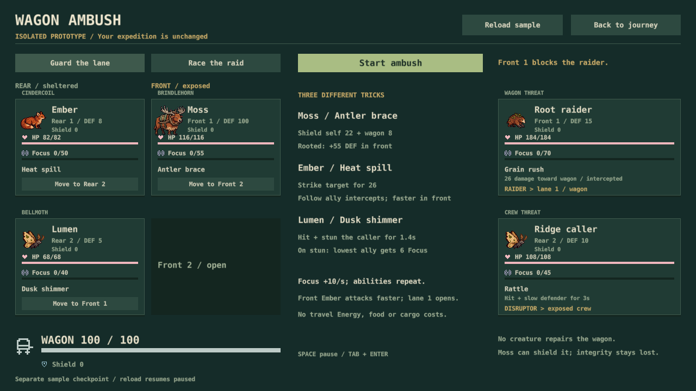
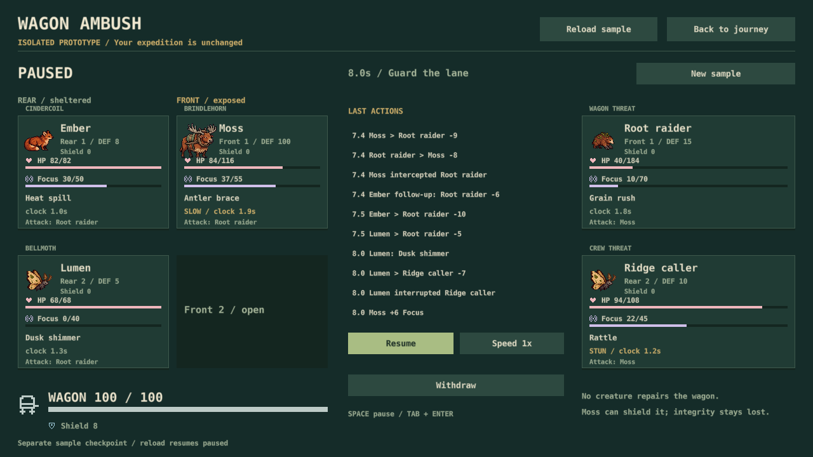
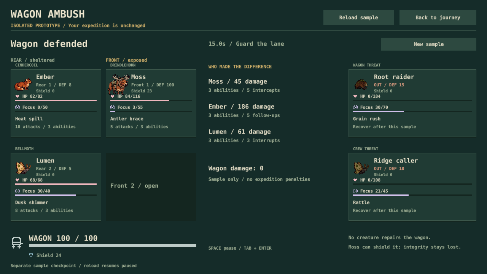
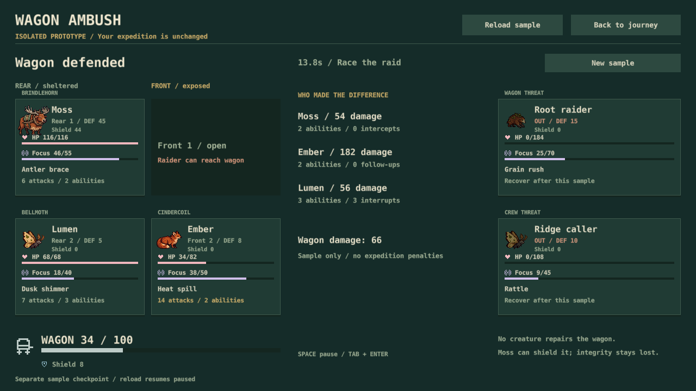

# S28 wagon ambush: focused playtest

November 1, 2026. Verdict: the isolated sample now demonstrates independent combatants, repeating abilities and a real wagon-defense decision. It is ready for owner hands-on testing. S29 kit/equipment depth and S30 expedition integration remain unfinished. Normal road battles still use their existing rules.

## What was played and checked

**New-player perspective:** inspected actual 1280×720 setup and fight captures, using only their labels to identify the raider, exposed lane, protected wagon and repeating Focus meter. Native production controls cover formation change, Start, keyboard activation, Space pause, speed, Reload, Withdraw and return to the journey. The F3 developer entry was exercised by a screenshot fixture. This was automated input and visual inspection, not an independent first-time human study or a physical-keyboard check.

**Expert perspective:** compared Guard the lane and Race the raid with the same three creatures and same opponent kits across seeds 1–24. Tested one/two-member resolver cases, loss of a defender, interrupted clocks, follow-up attribution, simultaneous wagon/last-foe failure, and defensive stalemate. The production controller was checked for focus loss, navigation and closing. No new full expedition sweep was necessary because this sample cannot settle costs into an expedition.

## What works

| Plan | Wins / 24 | Simulation duration | Wagon remaining | Why |
| --- | ---: | ---: | ---: | --- |
| Guard the lane | 24 | 15.0 s | 100 / 100 | Moss intercepts five hits; Ember contributes five follow-ups. The crew casts nine abilities. |
| Race the raid | 24 | 13.8–14.4 s | 18–34 / 100 | Ember's front position accelerates attacks. Lane 1 is open, so the wagon takes hits. The crew casts seven abilities. |

This supports a visible speed-versus-protection tradeoff in one sample, not balanced team-building across the whole game. Both use the same three species; S29 must add alternative kits and equipment before calling the build choices deep.

Lumen's interruption is visible in the log and on the caller's paused clock. Moss's shield and integrity are separate: a shield does not restore damage already taken. Per-creature result statistics explain repeated casts, interceptions and follow-ups. HP and Focus have distinct labeled readings; travel Energy is untouched.

## Already fixed during the pass

- The first two presets finished equally fast; the exposed front attacker now has a meaningful timing advantage at the cost of direct wagon exposure.
- Kept shield values visible on each creature; kept attack-clock values visible during slow/stun. These are remaining clock progress, not promises that no later interruption will occur.
- Removed stale target labels and ticking-action wording from finished results.
- A missing primary sample checkpoint now recovers the backup. Malformed/unknown records are rejected; save errors pause playback.
- Screenshot fixtures settle the simulated state before requesting a later rendered frame, avoiding mismatched evidence.

## Evidence and limits

122 Lua scenarios pass, including ten new ambush groups. Native tests pass for sample serialization, backup/corrupt-primary recovery, unchanged production saves and GUI/input integration, alongside the existing 36 GUI states. Actual sample captures cover setup, fight, both results and a wagon-failure fixture. The failure fixture intentionally starts the wagon at one integrity; it is an injected defeat-path check, not a normal full-health balance outcome. No Computer Use or firewall approval was needed.

Reproduce the 48 matched simulations with `.tools/luajit-64.exe reviews/evidence/wagon-ambush/compare.lua`. [Comparison data](../reviews/evidence/wagon-ambush/comparison.csv) and [capture input hashes](../reviews/evidence/wagon-ambush/source.json) retain provenance. The capture manifest records a dirty pre-commit feature tree; its input hashes identify the exact game/test/render inputs, not the older base commit alone.

No new art, combat audio, equipment pool, creature-collection expansion or expedition penalties are included. Physical input, listening, native activation-crash investigation and human pacing remain their previously recorded separate checks. Owner acceptance is still needed for the subjective question: can the player explain their team choice and enjoy watching it resolve?
